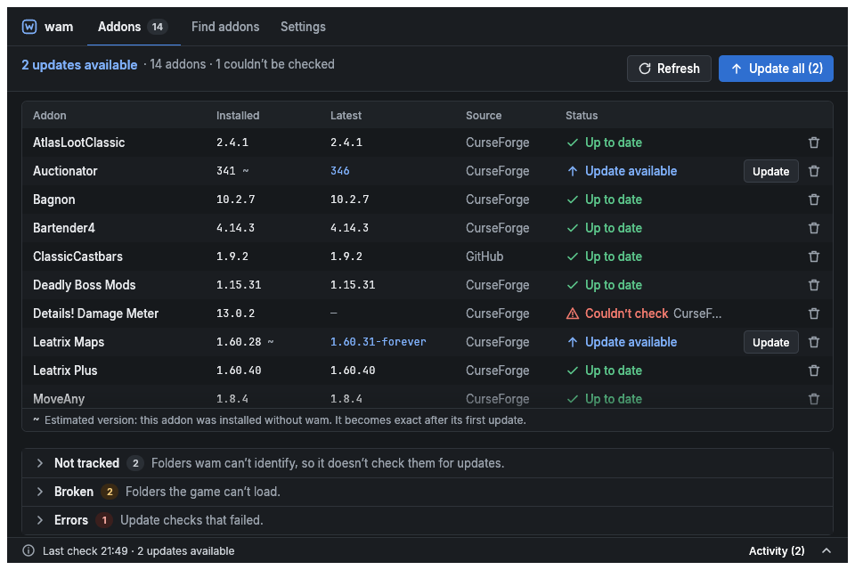

# wam: WoW Forever addon manager

`wam` checks your World of Warcraft Forever addons for newer versions, updates
them, and installs new ones from CurseForge and GitHub. Only builds made for the
Forever client (1.60.x) are picked. It comes as a desktop app and as a
command-line tool, for Windows and Linux.



## Download

**[Download for Windows](https://github.com/Avicted/wow-addon-manager/releases/latest/download/wam-gui-windows-amd64.exe)**
· [for Linux](https://github.com/Avicted/wow-addon-manager/releases/latest/download/wam-gui-linux-amd64)

Those links always fetch the newest version of the desktop app. The
[latest release](https://github.com/Avicted/wow-addon-manager/releases/latest) has every file:

| File | What |
|---|---|
| `wam-gui-windows-amd64.exe` | Desktop app for Windows |
| `wam-gui-linux-amd64` | Desktop app for Linux |
| `wam-windows-amd64.exe`, `wam-linux-amd64` | Command-line tool only |

`SHA256SUMS` lists their checksums. The desktop app already contains the command-line tool, so
you only need one of them.

- **Windows:** the files aren't code-signed, so SmartScreen shows "Windows protected your PC":
  choose *More info*, then *Run anyway*. Some antivirus tools may warn because the app unpacks
  and runs its built-in `wam.exe`. It needs Windows 10 or later with a DirectX 12 or Vulkan
  graphics driver; without one, use the command-line tool.
- **Linux:** `chmod +x wam-gui-linux-amd64`, then run it. It needs OpenGL (Mesa) and either
  Wayland or X11, which a desktop system already has.

## Desktop app

Open it, and the **Addons** tab shows what's installed and what has an update. **Update all**
(or **Update** on one row) installs the new versions; **Cancel** lets the current addon finish
and skips the rest. **Find addons** searches for and installs new ones, **Settings** holds the
AddOns folder. After updating, `/reload` in game.

On the first run it looks for your AddOns folder here, and asks you to pick it if it isn't:

- Windows: `C:\Program Files (x86)\World of Warcraft\_forever_\Interface\AddOns`
- Linux (Battle.net under Wine): `~/Games/battlenet/drive_c/Program Files (x86)/World of Warcraft/_forever_/Interface/AddOns`

Before wam replaces or removes an addon it saves it as a zip in `Interface/AddOns-backups/<addon>/`,
next to `AddOns`, and keeps the newest one. To put an addon back, unzip that file into `AddOns`.
Your settings in `WTF/` are never touched.

## Command line

```
$ wam status
ADDON         INSTALLED  LATEST           SOURCE        STATUS
Auctionator   341 ~      346              curse:6124    update
Leatrix Maps  1.60.28 ~  1.60.31-forever  curse:298842  update
Questie       v12.9.0    v12.9.0          github:...    ok

Not tracked (wam doesn't know where these come from):
  Journalator (+3 folders)  wam track Journalator <curseforge-url>

2 updates available. Run: wam update
```

| Command | Does |
|---|---|
| `wam status` | Installed and latest version of every addon |
| `wam update` | Update everything that has an update |
| `wam update Questie -n` | Only the named addons; `-n` shows what would change |
| `wam install <ref>` | Install a new addon |
| `wam search <text>` | Find addons that have Forever builds |
| `wam track <folder> <ref>` | Tell wam where an untracked folder comes from |
| `wam remove <addon>` | Remove an addon, keeping a zip backup |

`<ref>` is a CurseForge URL, slug (`details`) or project id (`curse:61284`), or a GitHub
repository (`github:Questie/Questie`). `wam -addons-dir <path> ...` sets the AddOns folder
(or `WAM_ADDONS_DIR`). `wam -json <command>` prints machine-readable events, see
[docs/DESIGN.md](docs/DESIGN.md).

## Running from source

Everything builds in Docker; the host needs only Docker and make. Clone this repository, then:

1. If WoW isn't in the default Battle.net/Wine location, point wam at your AddOns folder:
   `export WAM_ADDONS_DIR="/path/to/_forever_/Interface/AddOns"`
2. `make status` shows what's installed, `make update` updates everything.
3. `make search Q=details` finds an addon, `make install REF=details` installs it.
4. `make gui` builds the desktop app for both systems into `build/dist/`.

Without Docker, Go 1.27 works: `go install ./cmd/wam`, and each `make <command>` is `wam <command>`.
`make` lists every target; the table below maps them.

## Commands with make


Run `make` for the full list.

| Command | Does |
|---|---|
| `make gui-run` | Build and open the desktop app |
| `make status` | Installed and latest version of every addon |
| `make update` | Update everything that has an update |
| `make update ARGS="Questie -n"` | Only the named addons; `-n` shows what would change |
| `make install REF=<ref>` | Install a new addon |
| `make search Q=<text>` | Find addons that have Forever builds |
| `make track FOLDER=<folder> REF=<ref>` | Tell wam where an untracked folder comes from |
| `make remove NAME=<addon>` | Remove an addon, keeping a zip backup |

`<ref>` is a CurseForge URL, slug (`details`) or project id (`curse:61284`), or
a GitHub repository (`github:Questie/Questie`).

## Good to know

- Rows marked `~` were installed before wam; they're compared by `.toc`
  version until wam updates them once.
- Folders under "Not tracked" need `make track` so wam can update them.
- Backups are zips in `Interface/AddOns-backups`, beside the AddOns folder. `WAM_DATA_DIR` moves
  wam's state, not the backups.
- Set `GITHUB_TOKEN` to raise GitHub's 60 requests an hour limit.
- Output is colored on a terminal; set `NO_COLOR=1` to turn it off.

More: [how it works and its limits](docs/DESIGN.md), [development](docs/DEVELOPMENT.md).
